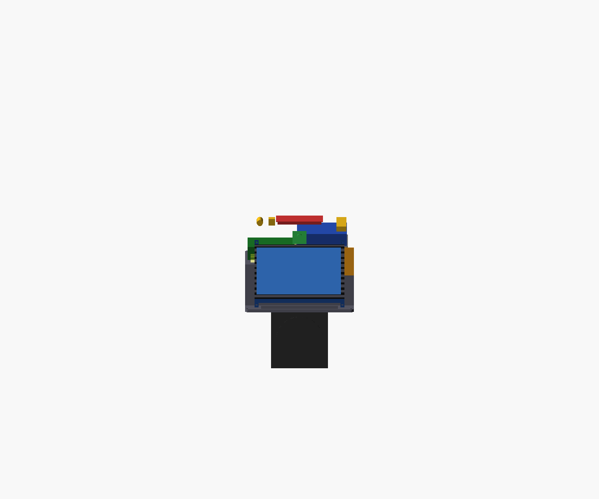
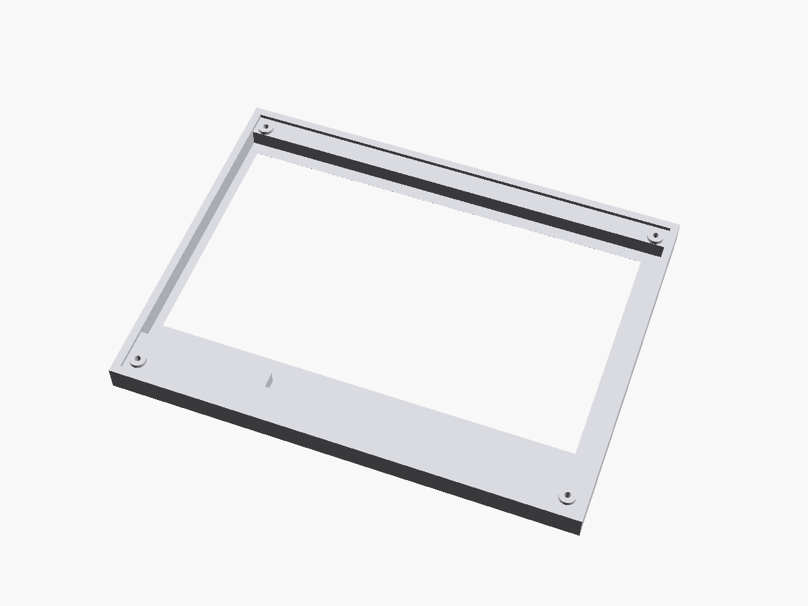

# 06 — Pantalla
Modelo: Waveshare 7inch HDMI LCD (C) Rev4.1, 1024×600, IPS, táctil capacitivo (USB).

**Orientación: horizontal (apaisada)**, para ver vídeo (YouTube, etc.) a pantalla completa. Es la orientación nativa del panel, así que no hace falta rotar nada en el sistema.

1024×600 es un formato ≈ 17:10. Un vídeo 16:9 ocupa todo el ancho y deja dos franjas negras finas, de unos 12 píxeles, arriba y abajo.

## Medidas
Las cotas del PCB, los taladros y los conectores salen del plano oficial de Waveshare. Las del cristal y el área visible, de fotos de la unidad real (±1 mm).

| Cota | Valor | Fuente |
|---|---:|---|
| Ancho total | 164,90 mm | plano |
| Alto total con pestañas | 124,27 mm | plano |
| Alto del PCB entre pestañas | 106,96 mm | plano |
| Hueco entre pestañas (arriba) | 148,90 mm | plano |
| Taladros de fijación | 4 × 156,90 × 114,96 mm entre centros, a 4,0 mm de los laterales | plano |
| Alto del cristal | ≈ 99,8 mm | foto |
| Área visible | 154,21 × 85,92 mm | hoja de datos |
| Margen cristal → área visible | izq. ≈ 3,6 · der. ≈ 7,1 · sup. ≈ 4,9 · inf. ≈ 9,0 mm | foto |
| Cristal → cara trasera del PCB | 9,5 mm | medido |
| Conectores detrás del PCB | 7 mm (HDMI) | medido |
| Diámetro de los taladros | 3,0 mm → tornillos M2.5 | medido |

## Conectores
Mirando la pantalla de frente, con el flex del LCD abajo:
- todos en el **canto derecho**, en la mitad superior;
- de arriba abajo, medido desde el borde superior de las pestañas: HDMI (18–34 mm), micro-USB del táctil (41–49 mm) e interruptor de retroiluminación (54–62 mm). El HDMI sobresale unos 2 mm del canto;
- las clavijas entran de lado (en horizontal), no por detrás.

Por eso hacen falta **clavijas acodadas** (D021):
- HDMI: cable plano HDMI-A → micro-HDMI con cabezales a 90°, o un adaptador HDMI a 90° + cable;
- táctil: cable micro-USB acodado → USB-A.

El modelo reserva 15 mm libres a la derecha del conector. Con la pantalla centrada, ese hueco llega justo a la pared interior. Cuando elijamos los cables concretos hay que confirmar que su clavija acodada cabe en 15 mm; si no, habría que desplazar la pantalla un par de milímetros a la izquierda o ensanchar la carcasa. Por esto mismo los laterales ya no se estrechan.

El interruptor de retroiluminación queda accesible solo con la carcasa abierta. Déjalo en ON.

## Marco de prueba
`enclosure/openscad/marco_pantalla_prueba.scad` → **`stl/marco_pantalla_prueba_v0_5.stl`** (172,5 × 130,9 × 9,9 mm).

Cómo distinguir las versiones con el calibre (mirando la cara vista, flex abajo):
| Versión | Exterior | Taladros |
|---|---|---|
| v0.1 | 171,5 × 130,9 | en espejo, 2,5 mm demasiado abajo |
| v0.2 (errónea) | **174** × 130,9 | desplazados 2,5 mm en horizontal |
| v0.3 | 171,5 × 133,4 | centrados respecto al cristal (según el plano): no coinciden |
| v0.4 | 175,5 × 130,9 | con la medida del 22/10; la plantilla mostró que había que subirlos 2,5 mm y llevarlos 5 mm a la izquierda (vista de frente) |
| **v0.5 (actual)** | **172,5** × 130,9 | izquierdo a 3 mm del borde izquierdo del cristal, inferior a 7,5 mm por debajo del cristal (vista de frente) |

**v0.5 (23/10/2026):** con la plantilla v0.4 montada, los taladros de la placa quedaban 2,5 mm más arriba y 5 mm a la derecha mirando la placa por detrás, que de frente es a la izquierda. En la v0.5, desde los bordes exteriores (cara vista, flex abajo): 7,3 mm del lateral izquierdo, 8,3 mm del derecho y 8,0 mm de arriba y de abajo. El PCB queda prácticamente alineado con el cristal (1 mm a la izquierda), así que la capucha vuelve a tener la pantalla centrada y 15 mm para las clavijas.

**Comprobación rápida antes de imprimir el marco:** `stl/marco_pantalla_plantilla_v0_5.stl` es una placa de 2 mm con el mismo contorno, el hueco exacto del cristal y los 4 taladros pasantes (≈15 g, 20–25 min). Ponla por delante sobre la pantalla con el cristal metido en el hueco y la marca «FLEX ↓» abajo: si un tornillo M2.5 entra por los 4 taladros hasta el PCB, las posiciones valen y ya se puede imprimir el marco (o la capucha). Se genera con `openscad -D 'pieza="plantilla"' …`. Para que salga aún más rápida: capa de 0,3 mm y 2 perímetros; la precisión en el plano no cambia con la altura de capa.

**Medida en la pantalla (22/10/2026, D043):** con el cristal como referencia, el centro del taladro izquierdo está a 8 mm de su borde izquierdo y el inferior a 10 mm por debajo de su borde inferior; los centros, a 156,9 × 114,96 mm como dice el plano. Por tanto el taladro superior queda ≈5 mm por encima del cristal, el derecho justo a la altura del borde derecho del cristal y el PCB (con sus conectores) unos 4 mm a la derecha del cristal. En la v0.4, medido desde los bordes exteriores del marco (cara vista, flex abajo): taladros a 11,3 mm del lateral izquierdo, 7,3 mm del derecho y 8,0 mm de arriba y de abajo.

**Resultado de la v0.1 (D035):**
- **Taladros:** los resaltes quedaban 2,5 mm más abajo que los taladros del PCB. Con la pantalla en su posición (flex abajo), el PCB está 2,5 mm más arriba respecto al cristal de lo previsto (`screen_pcb_dz = 2.5`). Corregido en el marco, en la capucha y en el volumétrico.
- **Ventana:** la v0.1 se generó en espejo. Como se imprime boca abajo, la ventana quedaba al revés: se veían 4 mm de borde negro a la derecha y tapaba 3 mm de imagen a la izquierda. Corregido desde la v0.2. La capucha no tenía ese error.
- **v0.2:** aplicó los 2,5 mm en horizontal por error (174 × 130,9 mm). La **v0.3** los aplica en vertical, como debe.

Sirve para comprobar el encaje real antes de imprimir la carcasa:
- ventana = área visible + 0,5 mm por lado, con chaflán de 1,5 mm hacia delante;
- 2 mm de material delante del cristal; el cristal entra desde atrás con 0,3 mm de holgura;
- el PCB solo apoya en 4 resaltes y se atornilla con **M2.5 × 6 autorroscantes** (agujero de 2,2 mm; cambiar `pilot_d` a 3,5 si prefieres insertos M2.5);
- hueco bajo el cristal para el flex del LCD;
- el canto derecho queda libre para los conectores.

**Impresión:** cara vista sobre la cama y sin soportes. PLA o PETG, capa de 0,2 mm y 3 perímetros.

**Qué comprobar al montarla:**
1. El cristal entra sin forzar y no baila (holgura: `fit`).
2. La ventana no tapa píxeles: enciende la pantalla y mira los cuatro bordes (margen: `win_margin`; si falta, revisa `screen_active_x0` y `screen_active_z0`).
3. Los taladros coinciden y el PCB queda plano sobre los resaltes, sin presionar el cristal.
4. El flex de abajo no roza.

