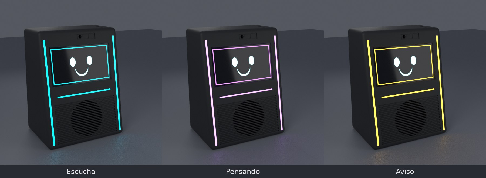

# 11 — Software
Puesta en marcha de la Raspberry: ver `17_raspberry.md`.


## Arquitectura (D036): todo en local, en la Pi 5
Objetivo: **que Prisma empiece a contestar en 1–3 s** en lo habitual, sin depender de la nube.

```text
"Prisma…" (openWakeWord)
   └► fin de frase (VAD, 0,3–0,5 s) ─► voz a texto (faster-whisper base, ≈1 s)
         └► ENRUTADOR DE ÓRDENES (sin IA, instantáneo)
               ├─ orden conocida ──────────► acción directa ───────────────┐
               │  (hora, temporizador, volumen, música, vídeo, luces de HA,│
               │   tiempo con Open-Meteo, «busca…» con respuesta directa)  │
               ├─ pregunta a Internet ─► SearXNG ─► respuesta directa o    │
               │                         resumen corto con el modelo       │
               └─ charla libre ───────► modelo pequeño (Ollama), en streaming
                                                                           ▼
                        texto a voz (Piper, frase a frase) ─► altavoz + avatar + LEDs
```

La clave es que **la IA solo trabaja cuando hace falta**: la mayoría de lo que se pide a un asistente son órdenes que se resuelven sin modelo de lenguaje. Y cuando trabaja, Prisma empieza a hablar con la primera frase, sin esperar a la respuesta completa.

### Tiempo hasta que empieza a hablar (estimado, desde que terminas de hablar)
| Tipo de petición | Ejemplo | Tiempo |
|---|---|---:|
| Orden directa | «Pon un temporizador de 10 minutos», «sube el volumen», «enciende la luz del comedor» | ≈ 1–1,5 s |
| Multimedia | «Pon música de Queen en Spotify», «pon en YouTube el último vídeo de…» | ≈ 1,5 s hasta la confirmación |
| Dato con respuesta directa | «¿Qué tiempo hará mañana?», «¿quién escribió…?» (ficha de Wikipedia) | ≈ 2–3 s |
| Charla libre | «Cuéntame un chiste», «explícame qué es un radiador pasivo» | ≈ 2–4 s |
| Pregunta a Internet que hay que resumir | «¿Qué ha pasado hoy con…?» | ≈ 5–8 s (dice «Lo busco» al momento) |

### Piezas
| Función | Elección | Notas |
|---|---|---|
| Palabra de activación | openWakeWord | Se puede entrenar «Prisma» |
| Voz a texto | faster-whisper (modelo *base*, int8) | Si falla mucho en español, *small* (más lento) |
| Enrutador | Frases de plantilla, al estilo de Home Assistant (hassil), y coincidencia aproximada | Ampliable sin programar |
| Modelo de lenguaje | Ollama con un modelo de 1,5–2B (Qwen3 1.7B, Gemma 4 e2b o el mejor del momento; se comparan en la Pi) | Siempre cargado; instrucciones cortas para que responda en 1–3 frases |
| Internet | SearXNG en Docker, en la propia Pi | Solo los 2–3 primeros resultados, recortados |
| Texto a voz | Piper, voz en español de España | Lee frase a frase mientras el modelo escribe |
| Casa | API de Home Assistant | Luces, persianas, escenas… |

## Multimedia
La pantalla de 7" y el altavoz convierten a Prisma también en reproductor. Todo se puede pedir por voz o con el dedo, y mientras suena algo el asistente baja el volumen al escuchar.

| Qué | Cómo | Control por voz |
|---|---|---|
| Vídeo y música locales | mpv (carpeta de la Pi o compartida por la red) | Sí |
| YouTube | mpv + yt-dlp, a pantalla completa | Sí: «pon en YouTube…» busca y reproduce |
| Spotify | Spotify Connect (librespot/Raspotify) con la cuenta Premium. Prisma aparece como altavoz en la app | Sí, con la API de Spotify y tu cuenta: busca y lanza en Prisma |
| Cualquier app del móvil | Prisma como altavoz Bluetooth y AirPlay (shairport-sync) | Pausa y volumen |

Mientras se ve un vídeo, la IA queda en reposo para no competir por la CPU. La Pi 5 descodifica por hardware HEVC; H.264 lo hace por software, sin problema a la resolución de la pantalla.

## Luz de estado (D033)


Las franjas de los cantos, la barra bajo la pantalla y un marco de color que la interfaz dibuja alrededor de la pantalla cambian juntos según el estado. Colores de partida (configurables):

| Estado | Franjas y barra | Marco en pantalla |
|---|---|---|
| Reposo | Apagadas o blanco cálido muy tenue (modo ambiente) | No |
| Escucha (tras la palabra de activación) | Cian fijo, sube de intensidad | Cian |
| Pensando | Pulso violeta que recorre las franjas de abajo arriba | Violeta tenue |
| Hablando | Cian; la barra sigue el volumen de la voz | Cian tenue |
| Micrófonos silenciados (interruptor, GPIO13) | Rojo tenue fijo en la barra | No |
| Aviso, temporizador o mensaje | Ámbar parpadeando despacio | Ámbar |
| Error o sin conexión | Naranja fijo | No |
| Cámara activa | Un LED blanco en lo alto de cada franja (privacidad) | — |
| Modo noche | Brillo al 10 % o apagado | — |

Límite de corriente de los LEDs: 0,6 A (ver `10_electronica.md`).
