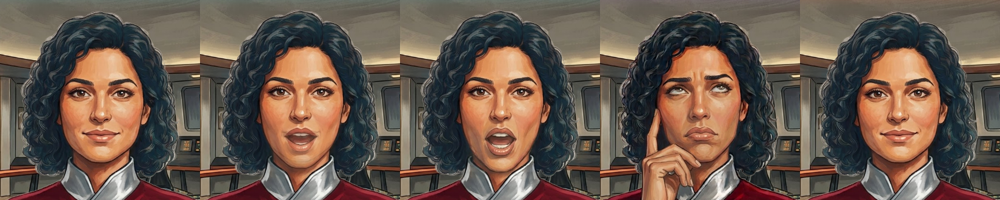
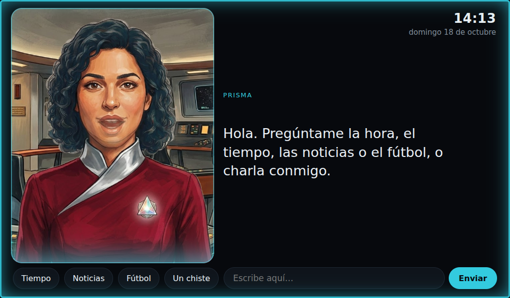

# 12 — Avatar

El avatar es un **retrato ilustrado animado (2,5D)** en estilo cómic semirrealista: una ilustración con capas
(ojos, boca, expresión) que el motor anima con pequeñas deformaciones. Se parece a la ilustración original
pero está viva, y para la Pi 5 es mucho más ligero que un personaje 3D (D041).

## Cómo funciona
- `software/interfaz/retrato.js` (WebGL, sin librerías) carga `/retrato/retrato.json`, que el servidor saca de:
  1. `~/.config/prisma/retrato/` — **tu retrato**, preparado con la herramienta de abajo;
  2. si no, `software/interfaz/retrato_muestra/` — la oficial científica de Prisma (imágenes de Pep, 18/10/2026), ya preparada.
- Si hay **decorado aparte** (`fondo`), la persona se recorta automáticamente y se pone delante; el decorado no se mueve.
- La imagen base se deforma con una malla: la cabeza se balancea e inclina alrededor del cuello y los hombros suben y bajan al respirar. Las capas (recortes pequeños con bordes difuminados) siguen la misma deformación, así que encajan siempre.
- Si no hay WebGL o falla algo, se queda la cara simple. Nada se rompe.
- El borde del retrato y un brillo abajo toman el color del estado, como el marco y las franjas LED.

| Estado | Capa | Movimiento |
|---|---|---|
| reposo | — | balanceo lento, respiración, parpadeo cada 2,5–6,5 s |
| escucha | `sonrisa` | inclina la cabeza |
| pensando / buscando | `piensa` | cabeza un poco arriba, sin parpadear |
| hablando | `boca_a/e/o/i/u` | bocas con fundido según el volumen de la voz |
| error | `triste` | — |

Las capas que falten simplemente no se usan. Si una variante cambia la postura (en `piensa` aparece la mano), se usa entera y se funde con la base en vez de recortarla.


 **Labios:** ahora se simula un ritmo de sílabas; con la voz (Piper) seguirán el volumen real: `window.avatar.nivel(0..1)`.



## Crear el personaje definitivo
Personaje **original**: oficial científico de una nave, estilo cómic semirrealista, uniforme propio y emblema de un prisma. Inspirado en la ciencia ficción de los 60, **sin elementos de Star Trek** (ni personajes, ni uniformes, insignias o puente de la serie). Responderá a «Ordenador».

### 1. Imagen base (cualquier generador de imágenes)
> Semi-realistic comic illustration, warm painted style, like a graphic novel. Bust portrait of a friendly woman science officer, about 35, looking straight at the viewer, mouth closed, soft neutral smile. Original sci-fi uniform: deep teal fitted tunic with a high asymmetric silver collar and a small glowing prism-shaped badge on the chest. Background: retro-futuristic 1960s spaceship control room, curved consoles with colourful backlit square buttons, large dark screens, soft lighting. Portrait format 4:5, centered, shoulders visible, front-facing.

Repite hasta que te guste. Debe mirar de frente y con la boca cerrada.

### 2. Variantes de la misma imagen
Sobre la imagen elegida, pide cambios pequeños **sin cambiar nada más** («keep everything else exactly the same»):
| Archivo | Petición |
|---|---|
| `ojos_cerrados` | same image, eyes gently closed |
| `boca_a` | same image, mouth open saying "a" |
| `boca_e` | same image, mouth saying "e", lips stretched |
| `boca_o` | same image, mouth round saying "o" |
| `piensa` | same image, eyes looking up to the side, thoughtful |
| `sonrisa` *(opcional)* | same image, warm open smile |
| `triste` *(opcional)* | same image, slightly worried expression |

Mínimo: `base`, `ojos_cerrados`, `boca_a` y `boca_o`. No importa si en las bocas cierra los ojos o si retoca la barbilla: de esas imágenes solo se toma la zona entre la nariz y la barbilla.
Opcional, `fondo`: el decorado sin la persona. Si está, la persona se recorta (fondo liso detrás de ella en las demás imágenes).

### 3. Prepararlas en la Pi
Copia las imágenes con esos nombres a una carpeta (p. ej. `~/retrato_nuevo/base.png`, `boca_a.png`…) y:
```bash
python3 ~/prisma/software/herramientas/prepara_retrato.py ~/retrato_nuevo
```
Si hay `fondo` necesita rembg (`pip install "rembg[cpu]" --break-system-packages`; descarga un modelo de 180 MB la primera vez y tarda ≈1 min en la Pi). También me puedes pasar las imágenes y te las preparo.
Alinea cada variante con la base, detecta qué zona cambia, iguala el color y recorta solo esa zona. Si el generador movió o retocó algo más, se ignora. Crea `~/.config/prisma/retrato/` con `retrato.json`; recarga la pantalla (`F5`).
En `retrato.json` se pueden ajustar a mano `cabeza` (centro y radio de lo que se balancea), `cuello_y`, `centro` (encuadre), `zoom` y `fondo.centro` (qué parte del decorado se ve).

## Alternativa 3D (VRM)
Sigue disponible el motor 3D (`avatar.js`, Three.js + three-vrm incluidos): si copias un personaje VRM a `~/.config/prisma/avatar.vrm` y no hay retrato propio, se usa ese.
