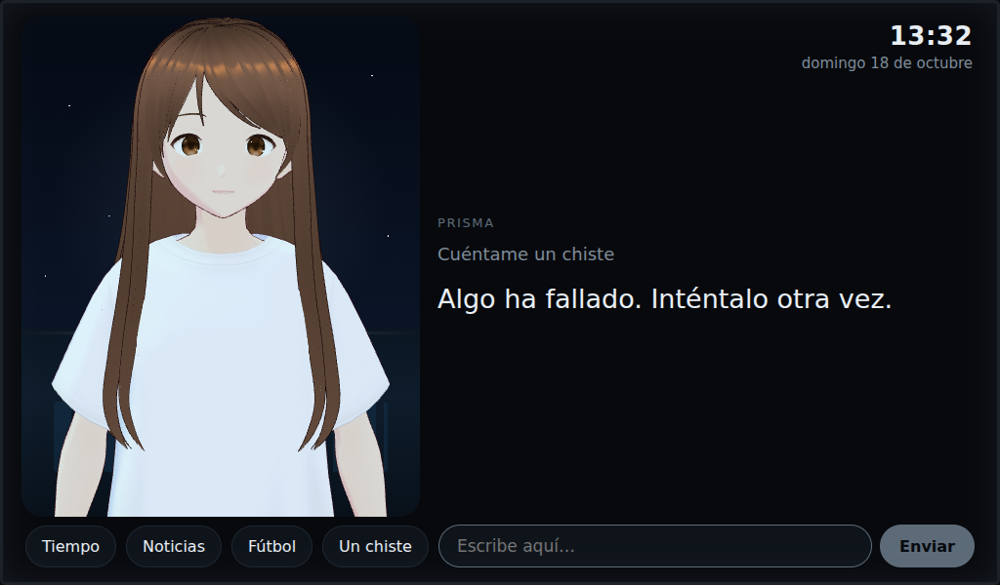

# 12 — Avatar

Personaje 3D en formato **VRM** dibujado en la pantalla con Three.js 0.180 y three-vrm 3.5 (WebGL de la GPU de la Pi 5).
Las librerías van incluidas en `software/interfaz/lib/` (≈1,1 MB, licencia MIT): no hace falta Internet para verlo.

## Cómo funciona
- `software/interfaz/avatar.js` carga `/avatar.vrm`, que el servidor saca de:
  1. `~/.config/prisma/avatar.vrm` — **tu personaje** (basta con copiarlo ahí y recargar);
  2. si no, `software/interfaz/modelos/muestra.vrm` — modelo de muestra de pixiv (VRM Public License 1.0) que descarga `04_interfaz.sh`, solo para probar el motor.
- Si no hay WebGL o el modelo no carga, se queda la cara simple de antes. Nada se rompe.
- Plano de busto, 30 fotogramas por segundo y resolución 1:1 para dejar la CPU a la IA.
- Fondo propio de «puente de mando»: ventanal con estrellas, consolas con luz tenue y una línea y un halo del color del estado.

## Animación
| Estado | Expresión | Mirada y cabeza |
|---|---|---|
| reposo | relajada | a la persona, con pequeños movimientos |
| escucha | atenta (sonrisa leve, cejas arriba) | inclina un poco la cabeza |
| pensando / buscando | concentrada | arriba a un lado, sin parpadear |
| hablando | amable | movimiento de labios (visemas aa, ih, ou, ee, oh) |
| error | apenada | — |

Siempre: respiración, parpadeo cada 2,5–6,5 s y balanceo suave.

**Labios:** de momento se simula un ritmo de sílabas mientras se muestra la respuesta. Cuando llegue la voz (Piper), se moverán con el volumen real del audio: `window.avatar.nivel(0..1)`.

## El personaje definitivo (D040)
Personaje **original**: oficial científico de una nave de ciencia ficción, semirrealista, con uniforme propio. Responde a «Ordenador» (palabra de activación, con los micrófonos).
Inspirado en el género, pero **sin elementos de Star Trek**: ni personajes, ni uniformes, insignias o interfaz de la serie (son marcas y diseños protegidos).

Requisitos del modelo VRM (sirven VRM 0.x y 1.0):
- Expresiones: `aa ih ou ee oh` (labios), `blink`, `happy relaxed sad surprised`. Las que falten simplemente no se mueven.
- Huesos de cuello, pecho y ojos (o `lookAt` por expresiones) para la mirada.
- Menos de ≈40 000 triángulos y texturas de 1024–2048 px para ir fluido en la Pi.
