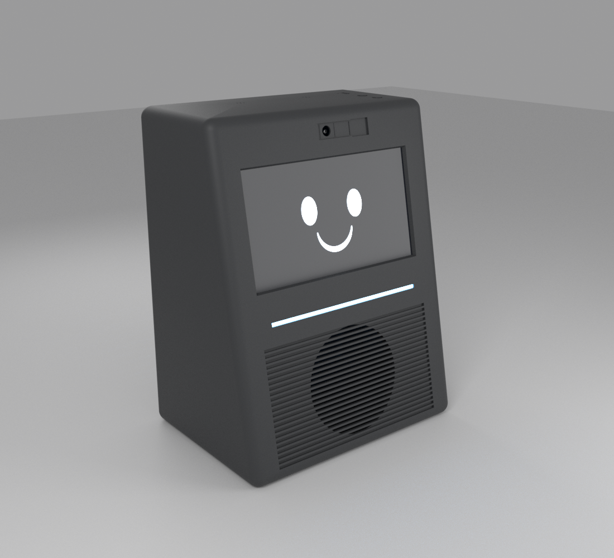
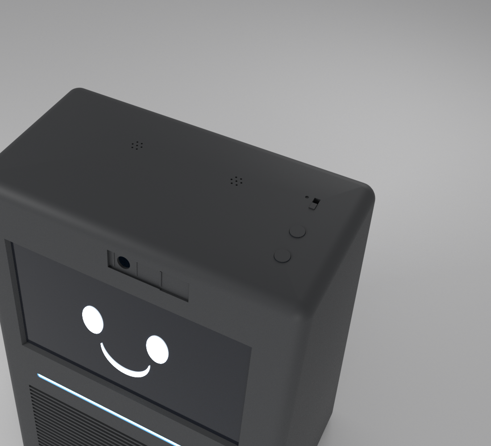
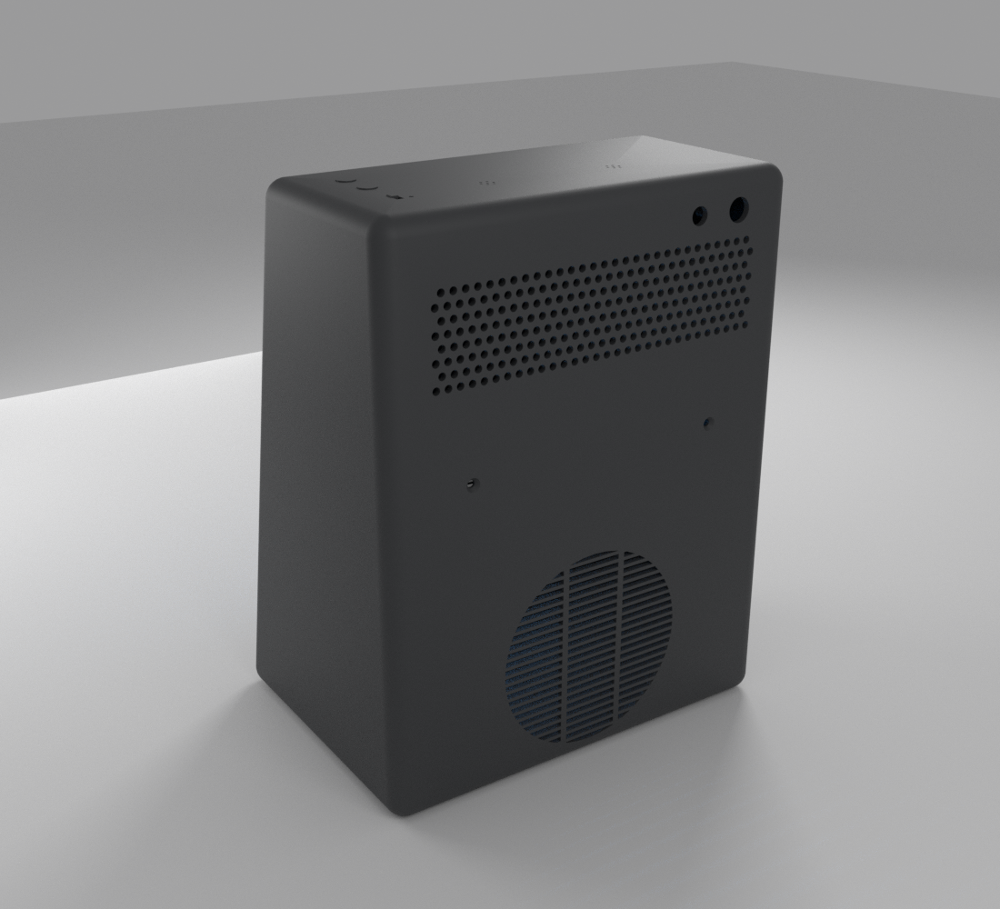

# 14 — Capucha (pieza 3) · v0.2

Es la parte de la carcasa que queda por encima de la cubeta acústica (z > 108 mm).
- **Archivo:** `enclosure/openscad/capucha.scad`.
- **STL:** en dos piezas (recomendado, D044) `stl/capucha_frente_v0_8.stl` + `stl/capucha_cuerpo_v0_8.stl`, ya orientadas para imprimir; de una pieza, `stl/capucha_v0_8.stl`. Más las piezas sueltas.

## División de la carcasa (D027)
| Pieza | Medidas | Material | Orientación |
|---|---|---|---|
| 1. Cubeta acústica | 205 × 148 × 108 mm | PLA negro mate | De pie |
| 2a. Bandeja delantera | 198 × 28 × 5 mm | PLA | Plana (ver `16_bandeja_caja.md`) |
| 2b. Caja superior de la cámara (suelo de la electrónica) | 198 × 98 × 79 mm | PETG | Boca abajo (ver `16_bandeja_caja.md`) |
| **3a. Capucha: frente** | **205 × 161 × 26 mm** | **PLA negro mate** | **Plana, cara vista sobre la cama** |
| **3b. Capucha: cuerpo** | **205 × 107 × 154 mm** | **PLA negro mate** | **Boca abajo (techo en la cama)** |

## Diseño (D031)
Vuelve al boceto original: frontal inclinado de arriba abajo, aristas redondeadas (r = 9 mm), laterales lisos y negro mate. En negro mate las líneas de capa apenas se ven, así que se quitan las estrías (D028 queda sin efecto).

## Qué lleva
| Elemento | Detalle |
|---|---|
| Pantalla | Ventana del área visible + 0,5 mm con chaflán de 1,5 mm. 4 resaltes con cartabón a 45° para tornillos M2.5 × 6 |
| Cámara | Agujero de 8 mm, 4 resaltes M2 y guía en cola de milano con zona de entrada para la tapa deslizante (D026) |
| Franja LED | Ranura de 142 × 3 mm entre la banda de lamas y la pantalla. Difusor transparente aparte (D033) |
| Franjas de los cantos (D033) | Ranura de 4 mm a 10,5 mm de cada lateral, justo dentro del redondeo. Detrás, un canal cerrado de 7 × 6 mm para la tira WS2812B de 5 mm, con salida de cables a la bahía por arriba. Abajo lo cierra la muesca de la bandeja |
| Micrófonos | 2 grupos de 7 agujeros de 1,2 mm en el techo y raíles para el ReSpeaker Lite |
| Botones (D032) | En el techo, a la derecha: dos capuchones de 8 mm (volumen − y +) y el interruptor deslizante de silencio, con un punto para pintar en rojo que queda a la vista al silenciar. Placa de botones atornillada por dentro |
| Trasera | Perforado de puntos de 3,5 mm (ventilación), conector DC y botón de encendido de 8 mm |
| Uniones (D029) | 2 pasadores delante (19 mm detrás del frontal, para dejar sitio al canal de las franjas), que encajan en la bandeja, y 2 tornillos M3 avellanados detrás, a la caja superior |

## Piezas sueltas
| STL | Material | Notas |
|---|---|---|
| `capuchones_botones_v0_1.stl` | PLA negro | Volumen −, volumen + y uno liso para el encendido. Asoman 0,5 mm y la pestaña interior los retiene |
| `deslizador_silencio_v0_1.stl` | PLA negro | Mando del SS12D00. Entra a presión en la palanca |
| `placa_botones_v0_1.stl` | PLA o PETG | Lleva 2 pulsadores de 6 × 6 × 5 mm y el SS12D00. Se fija con 2 tornillos M2 |
| `difusor_led_v0_3.stl` | PETG o PLA transparente | Se pega por dentro con su pestaña |
| `franja_sup_v0_2.stl` | PETG o PLA transparente | Tramo superior de las franjas (2 iguales). Entra deslizando por abajo, antes de montar la capucha; una gota de pegamento lo fija |
| `tapa_camara_corredera_v0_2.stl` | PLA negro | Usa la holgura que te haya ido bien con la pieza de prueba |

## Dos piezas (D044)
Para no necesitar soportes, la capucha se divide por un plano paralelo al frontal, a 22 mm de su cara exterior:
- **Frente** (≈125 g): pantalla (ventana y resaltes), cámara con su guía, ranura de la franja LED, canales de las franjas de los cantos, aristas redondeadas delanteras y los 2 pasadores de la bandeja. Se imprime **plano, con la cara vista sobre la cama**: la ventana y la ranura quedan como agujeros verticales y la cara vista sale con el acabado de la cama.
- **Cuerpo** (≈265 g): techo con micrófonos y botones, laterales y trasera. Se imprime **boca abajo**, como antes, pero ya sin los puentes de la ventana (155 mm) y de la ranura LED (142 mm), que eran los que obligaban a poner soportes.
- **Unión:** el frente lleva un **labio** de 4 mm que entra por dentro de laterales y techo del cuerpo (holgura 0,2 mm) y lo alinea; **3 tornillos M3 × 10 de cabeza Allen** en el techo, puestos desde dentro del cuerpo, que roscan en **insertos M3 × 5** del frente; abajo, los 2 pasadores del frente entran en la bandeja. En los laterales no hay tacos: detrás están la caja de la cámara acústica y los conectores de la pantalla.
- **Montaje:** insertos en el frente (soldador), encajar el frente en el cuerpo, atornillar los 3 M3 desde dentro y montar la capucha como siempre.
- Los botones del techo van 6 mm más atrás (y = 84, 102 y 124 mm) para no quedar sobre la junta.

Comprobado con `tools/comprobar_capucha.py`: las dos piezas cerradas, sin solaparse entre sí y sin chocar con ningún componente. Voladizos de más de 45° solo en los primeros milímetros de las aristas redondeadas que tocan la cama (igual que antes); ninguno en el aire.

## Impresión
- **Frente:** cara vista sobre la cama, sin soportes. PLA negro mate, capa de 0,2 mm, 3 perímetros, 15 % de relleno. Cama lisa o texturizada según el acabado que quieras en el frontal.
- **Cuerpo:** boca abajo, con el techo sobre la cama, sin soportes. Mismos ajustes.
- **De una pieza** (si se prefiere): boca abajo; necesita soportes en la ventana y en la ranura LED.
- **Aristas redondeadas que tocan la cama:** solo los últimos 2–3 mm del redondeo superan los 45°. Con PLA y buena ventilación salen sin soportes.

## Comprobación
`python3 tools/comprobar_capucha.py` comprueba que la malla está cerrada, que cabe en la cama y que no choca con los componentes.

## Pendiente de verificar
- Posición de los micrófonos del ReSpeaker Lite (los grupos de agujeros toleran ±3 mm).
- Alto del objetivo de la cámara (`cam_standoff`).
- Ajuste del deslizador sobre la palanca del SS12D00 y del capuchón sobre el pulsador.

**v0.5 (D043):** resaltes de la pantalla en su posición medida respecto al cristal (izquierdo a 8 mm del borde del cristal, inferior a 10 mm por debajo). El PCB va 4 mm a la derecha del cristal, así que la pantalla se desplaza 2 mm a la izquierda del centro y el hueco para las clavijas acodadas queda en 13 mm (antes 15).

**v0.6:** resaltes 2,5 mm más arriba y 5 mm a la izquierda (vista de frente), comprobados con la plantilla. Pantalla centrada otra vez y hueco de clavijas de 15 mm.

**v0.7:** resaltes de la pantalla 1 mm más abajo (plantilla v0.5).

**v0.8 (D044):** capucha en dos piezas (frente + cuerpo) sin soportes; botones del techo 6 mm más atrás.
