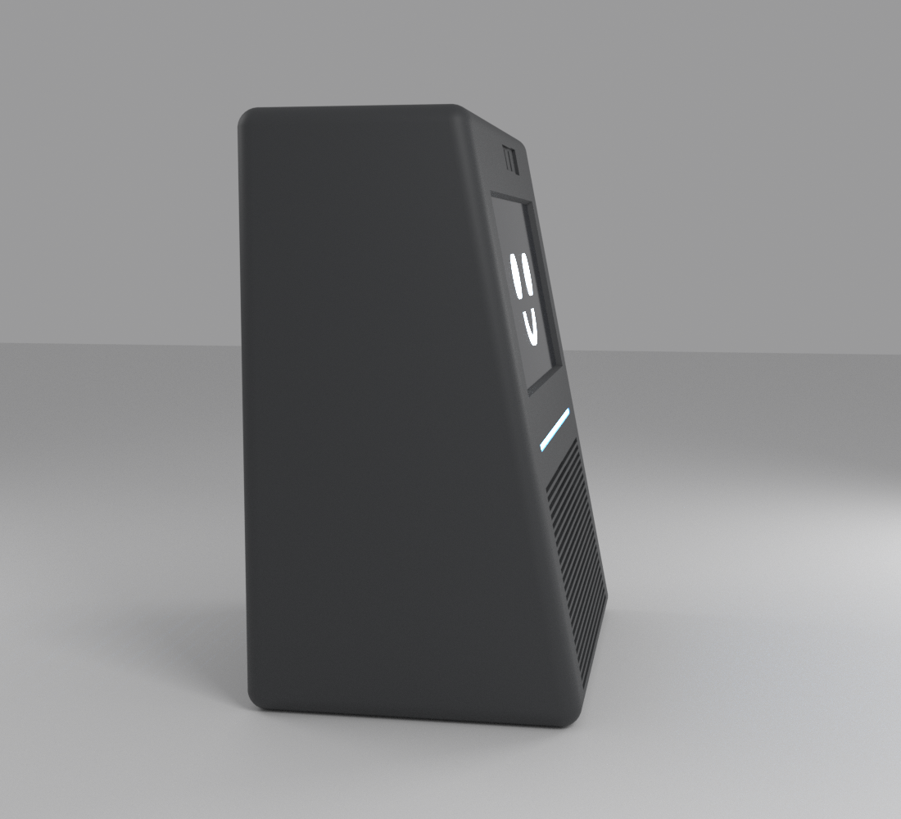
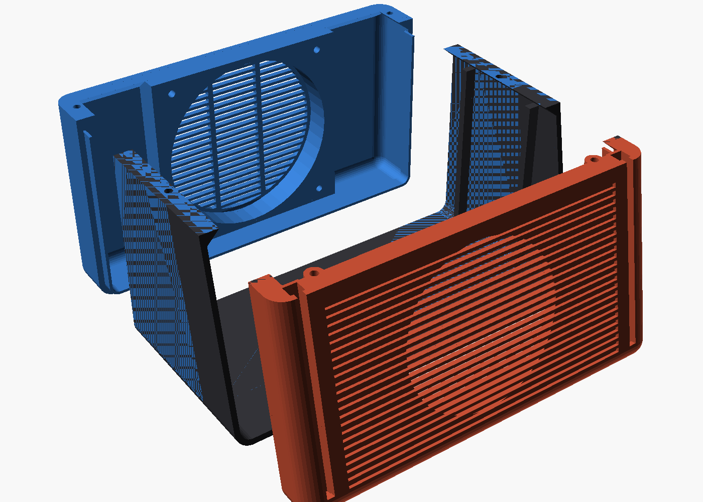

# 15 — Cubeta acústica (pieza 1) · v0.5

Es la parte inferior de la carcasa (z 0–108 mm) y forma el bloque principal de la cámara acústica.
- **Archivo:** `enclosure/openscad/cubeta.scad`.
- **STL en tres piezas (D046), ya orientadas para imprimir:** `stl/cubeta_frente_v0_6.stl`, `stl/cubeta_centro_v0_6.stl` y `stl/cubeta_trasera_v0_6.stl`, más `stl/pata_tpu_v0_2.stl` (× 4). De una pieza, `stl/cubeta_v0_6.stl` (205 × 148 × 108 mm, unos 390 cm³).

## Tres piezas (D046)

De una pieza son unas 23 h seguidas de impresora. En tres piezas, cada una cabe en una sesión de día:

| Pieza | Qué lleva | Cómo se imprime | Tiempo (capa 0,2 / 0,28 mm) |
|---|---|---|---|
| Frente | Frontal con las lamas, anillo del altavoz, canales de las franjas, resaltes de la bandeja y reborde delantero | Tumbada, cara vista sobre la cama | ≈ 7 h / 5,5 h |
| Centro | Suelo y laterales, con los nervios, los rebordes laterales y las patas | De pie, suelo en la cama | ≈ 8,5 h / 7 h |
| Trasera | Trasera con la rejilla y el anillo del radiador | Tumbada, cara vista sobre la cama | ≈ 7,5 h / 6 h |

Tiempos estimados con un perfil genérico (3 perímetros, 20 % de relleno) que da 23,5 h para la pieza entera; con tu perfil de la Kobra X saldrán parecidos.

- **Cortes:** el del frente es paralelo al frontal, a 20 mm de su cara exterior; el de la trasera, vertical a 28 mm de la cara trasera. Los dos quedan lejos de los anillos, de los insertos y de las patas (que pasan a y = 36 y 132 mm).
- **Guías:** el frente y la trasera llevan un **labio interior en U** (suelo y laterales, 1,6 mm de grueso) que entra 6 mm en el centro con 0,2 mm de holgura. Alinea las piezas y tapa la junta por dentro. Su raíz tiene un chaflán escalonado a 45°, así que todo se imprime sin soportes.
- **Unión:** **pegadas**, porque la cámara acústica tiene que quedar estanca. Pegamento de cianoacrilato en gel o epoxi de 5 minutos por el labio y por los cantos; presenta primero en seco, luego pega y sujeta con cinta de carrocero o gomas hasta que seque. Si queda algún resquicio, un cordón fino de silicona por dentro.
- **Orden:** monta primero el centro con el frente, comprueba que los rebordes de arriba quedan a nivel y después la trasera.

## Banda de lamas y altavoz (D030, D031)
- **Banda de lamas:** el frontal inclinado lleva una banda horizontal de lamas de 2,4 mm cada 4 mm, a todo lo ancho (22 mm de margen por lado).
- **Delante del cono:** dentro de un círculo de 86 mm las lamas atraviesan la pared y dejan salir el sonido.
- **Resto de la banda:** es decorativo. Las lamas solo tienen 1,8 mm de fondo, así que la cámara queda cerrada.
- **Montaje del altavoz:** va por dentro, sobre un anillo paralelo al frontal que deja 7 mm hasta la rejilla, y queda inclinado 11° hacia el usuario.
- **Radiador:** va detrás, con una rejilla circular de 94 mm y un anillo de 14 mm (su recorrido llega a 9 mm).
- **Fijación:** 4 insertos M3 por anillo a ±44,9 mm (89,8 entre centros, medido) y junta de espuma de 2 mm.
- **Recortes (v0.6, medidos):** la cesta del altavoz y la del radiador miden 98,8 mm, así que los dos recortes pasan a 99,8 mm (antes 90 y 98,4). Fondo del altavoz 50,2 mm; radiador 50 mm hasta la goma y 60 mm hasta la palometa de la masa.

## Resto de la pieza
| Elemento | Detalle |
|---|---|
| Rebordes interiores | Delante (a todo lo ancho, D034), en los laterales y en la trasera (fuera del radiador), con chaflán a 45°. Ahí apoyan la bandeja (2a) y la caja superior (2b). 4 insertos M3 en los laterales para los tornillos de la caja |
| Resaltes de la bandeja | 2, junto al frontal y a 25 mm de cada lateral, con inserto M3 |
| Refuerzos | 2 nervios verticales por lateral |
| Patas | 4 alojamientos de 16 mm para patas de TPU de 5 mm, en y = 36 y 132 mm (fuera de los cortes) |
| Franjas de luz (D033) | Ranura de 4 mm en cada canto del frontal y canal cerrado detrás para la tira WS2812B. El canal está separado de la cámara acústica y solo se abre por arriba, hacia la capucha. El inserto transparente `franja_inf_v0_2.stl` (2 iguales) entra deslizando desde arriba |

## Volumen de la cámara
`tools/comprobar_cubeta.py` mide el volumen real:

| Concepto | Litros |
|---|---:|
| Aire del volumétrico | 3,54 |
| Ocupado por la cubeta (incluidos los canales de las franjas) | −0,13 |
| Aire delante de los conos (fuera de la caja) | −0,15 |
| Reserva (espuma, cableado) | −0,10 |
| Paredes de la caja superior (2b, medidas) | −0,07 |
| **Neto** | **≈ 3,08** (ver `16_bandeja_caja.md`) |

La simulación con 3,1 L ya está hecha (ver `05_audio.md`): radiador + 10 g, sintonía ≈ 44 Hz, ≈ 10 W útiles y ≈ 94 dB a 100 Hz.

## Impresión
- De pie, suelo en la cama, PLA negro mate, 3–4 perímetros, 20 % de relleno. Sin soportes.
- Patas en TPU al 100 %.
- Insertos de las franjas: PETG o PLA transparente, tumbados con la cara vista sobre la cama (la textura de la cama los deja esmerilados y difunden mejor).

## Pendiente de verificar con las piezas reales
- **Holgura entre el imán del altavoz y la palometa del radiador:** con las profundidades medidas, la palometa queda casi tocando la parte trasera del altavoz en reposo, y al moverse el radiador (9 mm hacia dentro) chocaría. El modelo del altavoz es conservador (cilindro de 85 mm hasta el fondo); falta el diámetro real del imán y el ancho de la palometa para decidir si hay que desplazar el radiador hacia un lado.
- Grosor del marco y cuánto sobresale la suspensión de cada cono por delante del marco (`drv_clear`, `pr_clear`).
