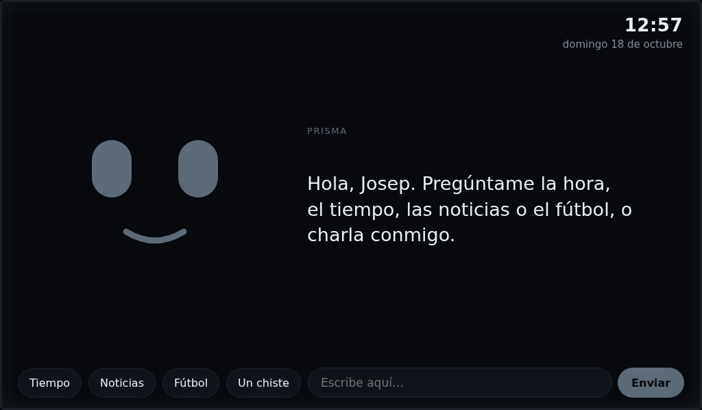
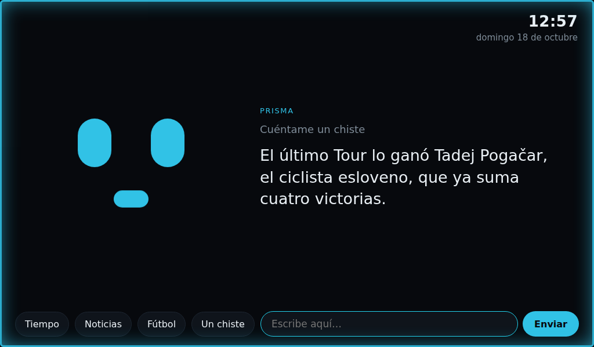
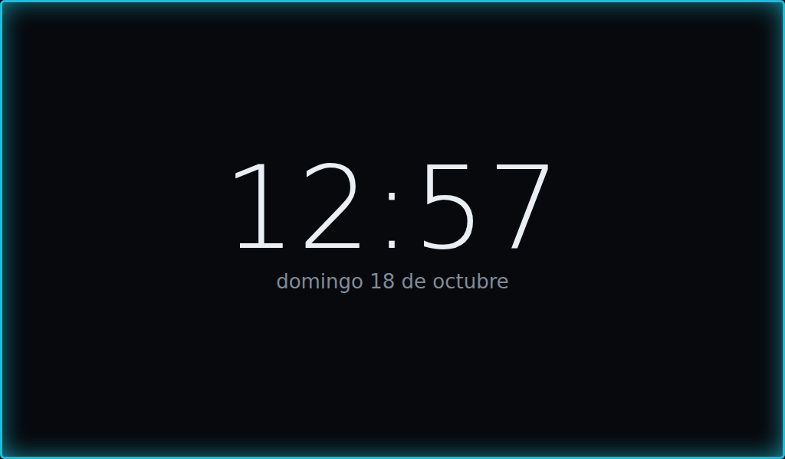
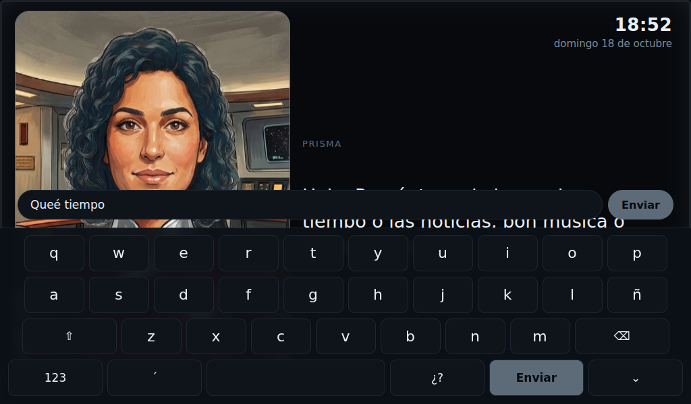
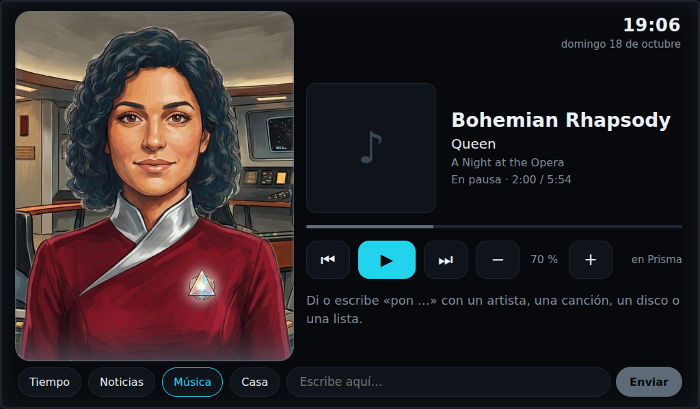

# 17 — Puesta en marcha de la Raspberry Pi 5

Primera fase con lo que ya hay: **Pi 5 + pantalla Waveshare 7" (C) + cámara OV5647**. Los micrófonos, el DAC, los LEDs y los botones se añadirán en pasos siguientes.

## 1. Grabar el sistema (en tu ordenador)
1. Instala **Raspberry Pi Imager** (raspberrypi.com/software) y mete la tarjeta microSD: **64 GB, clase A2** (32 GB valen, pero van justos con varios modelos de IA).
2. Dispositivo: **Raspberry Pi 5**. Sistema: **Raspberry Pi OS (64-bit)**, el normal, con escritorio (D037): la interfaz, los vídeos y YouTube necesitan entorno gráfico (Lite no sirve) y Full trae programas que no se usan. 64 bits por Ollama.
3. En «Personalización» (el engranaje o «Editar ajustes»):
   - Nombre de equipo: `prisma`.
   - Usuario y contraseña: los que quieras (los scripts no dependen del nombre).
   - Wi-Fi: tu red, país `ES`.
   - Zona horaria `Europe/Madrid`, teclado `es`.
   - Servicios: **activar SSH** con contraseña.
4. Graba la tarjeta.

## 2. Conexiones
| Qué | Dónde |
|---|---|
| Pantalla, vídeo | Cable micro-HDMI → HDMI al puerto **HDMI0** de la Pi (el que está junto al USB-C de alimentación) |
| Pantalla, táctil y alimentación | Cable micro-USB del conector *Touch* de la pantalla a un USB de la Pi |
| Cámara | Cable de 22 → 15 pines: el extremo estrecho al conector **CAM/DISP 0** de la Pi y el ancho a la cámara. Con la Pi apagada; contactos dorados según el dibujo del conector |
| Alimentación | De momento, la fuente oficial de 27 W (5 V, 5 A) de la Pi 5 |

El interruptor *Backlight* de la pantalla, en ON.

## 3. Primer arranque y configuración
1. Enciende. La primera vez tarda un par de minutos.
2. Abre una terminal en la propia Pi o entra por SSH desde tu ordenador: `ssh tu_usuario@prisma.local`.
3. Descarga el repositorio y lanza la configuración base:
   ```bash
   git clone https://github.com/PepVentura/Prisma.git ~/prisma
   bash ~/prisma/software/instalacion/01_base.sh
   sudo reboot
   ```
   El script actualiza el sistema, instala lo necesario, activa el SPI (para los LEDs) y añade a `/boot/firmware/config.txt` un bloque de Prisma, con las líneas de la cámara, el DAC y la alimentación comentadas hasta que hagan falta.

## 4. Comprobaciones
**Pantalla:** debe verse a 1024 × 600 y el táctil debe mover el puntero. Las líneas `hdmi_cvt` de la wiki de Waveshare son del sistema antiguo y la Pi 5 las ignora. Si la imagen sale mal, añade al final de la única línea de `/boot/firmware/cmdline.txt` (separado por un espacio):
```
video=HDMI-A-1:1024x600M@60
```

**Cámara:**
```bash
bash ~/prisma/software/instalacion/prueba_camara.sh
```
Lista la cámara, enseña 5 s de imagen y guarda `~/prueba_camara.jpg`. Si dice *No cameras available*:
1. Revisa el cable: que esté bien metido en los dos extremos y con los contactos del lado correcto.
2. Si sigue sin verla, en `config.txt` pon `camera_auto_detect=0` y quita el `#` de `dtoverlay=ov5647,cam0`.

## 5. El cerebro
Todo en local, en la propia Pi, con consultas a Internet a través de SearXNG. La arquitectura y los tiempos de respuesta están en `11_software.md` (D036).

## 6. Paso 2: IA local y buscador
```bash
bash ~/prisma/software/instalacion/02_ia.sh
```
- Instala **Ollama**, que deja el modelo siempre cargado y solo accesible desde la propia Pi, y descarga el modelo de Prisma, **qwen3:1.7b** (D038).
- Instala **Docker** y **SearXNG**, en el puerto 8888, solo para la Pi, con respuestas en JSON y en español.
- Si se corta la conexión, vuelve a lanzarlo y continúa donde se quedó.
- **Si falla la descarga del modelo con un error de certificado** en fin de semana, son los bloqueos de LaLiga a Cloudflare (mira hayahora.futbol). Espera a que acaben los partidos o usa una VPN.

**Probar el modelo y una búsqueda:**
```bash
python3 ~/prisma/software/herramientas/prueba_ia.py --modelo qwen3:1.7b
python3 ~/prisma/software/herramientas/prueba_ia.py --modelo qwen3:1.7b --buscar "¿quién ganó el último Tour de Francia?"
```

### Resultados en la Pi 5 (18/10/2026)
| Modelo | 1.er token | 1.ª frase | Generación | Lectura |
|---|---:|---:|---:|---:|
| **qwen3:1.7b** | 0,7 s | **3,0 s** | 9,8 tok/s | 155 tok/s |
| qwen2.5:3b | 1,1 s | 4,8 s | 6,0 tok/s | 91 tok/s |
| qwen3.5:2b | 2,3 s | 6,6 s | 4,8 tok/s | 33 tok/s |

Búsqueda con qwen3:1.7b ya cargado: 9,1 s hasta la primera frase (SearXNG 3,0 s, lectura de 368 tokens 3,3 s, primera frase 2,8 s). Objetivo con los ajustes del núcleo: 3–4 s. El tiempo meteorológico irá por Open-Meteo, no por el buscador, porque el modelo pequeño inventa detalles cuando la búsqueda no trae el dato.

Para volver a comparar modelos: `bash ~/prisma/software/instalacion/02_ia.sh --comparar` y `python3 ~/prisma/software/herramientas/prueba_ia.py --comparar`.

## 7. Paso 3: Prisma por texto
```bash
git -C ~/prisma pull
bash ~/prisma/software/instalacion/03_nucleo.sh
python3 ~/prisma/software/prisma_texto.py --tiempos
```
Es el núcleo del asistente sin voz: escribes y responde como lo hará hablando.
- **Enrutador.** Busca en Internet cuando se lo pides («busca…», «mira si…») o cuando la pregunta depende de datos actuales: hoy, último, precio, quién ganó… Si no, charla con el modelo.
- **Búsqueda ajustada.** Cada buscador tiene 1,5 s para responder. El modelo lee solo 2 resultados de unos 280 caracteres, o la respuesta directa del buscador y 1 resultado.
- **Charla.** Recuerda los últimos mensajes y contesta en 1–3 frases. Las instrucciones son fijas para que Ollama no tenga que releerlas.
- **Voz.** La respuesta aparece por trozos: al final de cada frase, o en una coma si ya lleva unas cuantas palabras. Cada trozo es el momento en que Piper podría empezar a leer.
- Con `--tiempos` muestra el desglose: búsqueda, lectura, cuándo empezaría a hablar y el total.

### Mejoras tras la primera prueba (18/10/2026)
| Lo que pasó | Arreglo |
|---|---|
| Prometía memorizar tu nombre, pero no podía | Memoria real: «me llamo…», «recuerda que…» y «olvida…» se guardan en `~/.config/prisma/memoria.json` y se añaden a sus instrucciones. Responde al instante, sin pasar por el modelo |
| Preguntaba «¿quieres que te cuente un chiste?» en vez de contarlo | Instrucciones más claras: hacer directamente lo que se pide, sin chistes de política y sin prometer lo que no puede hacer |
| El Tour: «Gino Bartali» (falso) y 356 tokens leídos | Las búsquedas ya no arrastran la conversación anterior (≈150 tokens), el modelo sabe la fecha de hoy y se le pide que diga que no lo encuentra en vez de inventar. Con `--resultados` se ve lo que ha leído |
| La primera frase larga retrasaba la voz (5,4 s) | Empieza a hablar en una coma a partir de 4 palabras, o a las 12 palabras |
| La charla se iba alargando | Recuerda los 4 últimos mensajes, con el texto exacto, para que Ollama no tenga que releerlos |

Límite conocido: un modelo de 1,7B se equivoca en conocimientos técnicos poco comunes (explicó el radiador pasivo como el de un coche). Para datos concretos es mejor que busque.

### Segunda prueba (18/10/2026)
| Lo que pasó | Arreglo |
|---|---|
| Guardaba el nombre, pero a «¿cómo me llamo?» respondía mal: repetía su respuesta anterior y no hacía caso a sus instrucciones | «¿Cómo me llamo?», «¿quién soy?» y «¿qué sabes de mí?» se contestan directamente desde la memoria, sin el modelo. Al cambiar la memoria se borra la conversación, para que no repita respuestas superadas |
| «Gino Bartali» salía del buscador: un resultado de Wikipedia sobre el Tour de 1938 | Las consultas que dependen de la fecha llevan el año o el día: «el último Tour» → «… 2026», «noticias de hoy» → «… 18 octubre 2026». Lee 3 resultados de 200 caracteres en vez de 2 de 280 |

## 8. Paso 4: fuentes fiables (D039)
La IA de 1,7B se inventaba datos al resumir búsquedas (un 2-1 de la Real que no existía). Ahora el modelo **solo charla**, y todo lo que son datos sale de fuentes que no pueden inventar:

| Pregunta | Fuente | Ejemplo de respuesta |
|---|---|---|
| Hora y fecha | Reloj de la Pi | «Son las 11:38 de la mañana.» |
| El tiempo | Open-Meteo (gratis, sin clave) | «Mañana en Donostia: lluvia débil, entre 12 y 18 grados, con un 80 % de probabilidad de lluvia.» |
| Fútbol | football-data.org (gratis, con clave) | «El sábado 17 de octubre, Athletic 0, Real Sociedad 2. Real Sociedad ganó.» |
| Noticias | RSS de El Periódico, La Vanguardia, Deia, EITB y TV3 (3CatInfo, en catalán) | «Titulares de Deia. …» |
| Otras búsquedas | SearXNG: el fragmento más relevante, tal cual | «Según marca.com: Tadej Pogačar ganó el Tour de Francia 2026…» |
| Charla | qwen3:1.7b | — |

**Configuración (una vez):**
1. **Noticias.** Busca y guarda los RSS de los periódicos:
   ```bash
   python3 ~/prisma/software/prisma_texto.py --configurar-noticias
   ```
   Si alguno sale «NO ENCONTRADO», se puede poner su RSS a mano (ver punto 3).
2. **Fútbol.** Regístrate gratis en football-data.org (plan *Free*). Te mandan la clave por correo.
3. **Ajustes personales** en `~/.config/prisma/nucleo.json` (ninguno es obligatorio salvo la clave del fútbol):
   ```json
   {
     "futbol_clave": "LA_CLAVE_QUE_TE_MANDEN",
     "ciudad": "Donostia",
     "equipo": "Real Sociedad"
   }
   ```
   Para crearlo: `nano ~/.config/prisma/nucleo.json`, pega, cambia la clave, `Ctrl+O`, Intro, `Ctrl+X`.

Ejemplos: «¿qué tiempo hará mañana?», «¿va a llover el sábado en Bilbao?», «¿cómo quedó la Real?», «¿cuándo juega el Athletic?», «¿cómo va la clasificación?», «dame las noticias», «titulares de EITB», «busca recetas de marmitako».

### Prueba de las fuentes (18/10/2026)
Noticias, tiempo, hora y búsqueda responden en 0,0–0,8 s. Ajustes tras la prueba:
- **Erratas:** «los titukares de deia» iba a la charla. Ahora se corrigen las palabras clave con erratas («titukares» → «titulares»).
- **Preguntas de seguimiento:** «¿y mañana?», «¿y en Bilbao?», «¿y el domingo?», «¿y de TV3?», «¿y el Athletic?» repiten la consulta anterior cambiando solo ese dato.
- **Tiempo:** ya no dice «llovizna… sin lluvia prevista». Si el cielo anuncia lluvia o la probabilidad pasa del 10 %, da el porcentaje.
- **Hora:** de 12 a 15 h dice «del mediodía» (antes «12:30 de la mañana»).

## 9. Paso 5: la interfaz en la pantalla
```bash
git -C ~/prisma pull
bash ~/prisma/software/instalacion/04_interfaz.sh
sudo reboot
```
Al encender, la Pi arranca directamente en Prisma a pantalla completa:
- **Avatar** a la izquierda: retrato ilustrado animado (ver [12_avatar.md](12_avatar.md)). Respira, parpadea, balancea la cabeza, cambia de expresión con el estado y mueve los labios al hablar. Mientras no tengas tu personaje se ve un retrato provisional.
- **Marco de luz** del color del estado, el mismo que llevarán las franjas LED (D033).
- **Conversación** a la derecha: tu pregunta en gris y la respuesta grande. Las fuentes de las búsquedas, en gris.
- **Accesos rápidos:** Tiempo, Noticias, **Música** (lo que suena en Spotify, ver §10) y **Casa** (Home Assistant a pantalla completa, con «← Prisma» para volver).
- **Teclado en pantalla** al tocar «Escribe aquí…»: español con ñ, tilde (´ y luego la vocal), ¿?, números y signos (123). «⌄» o tocar fuera lo esconde; ⌫ mantenido borra seguido. Sigue funcionando un teclado físico.
- **Reposo:** tras 90 s sin uso, reloj grande con la fecha y el tiempo de hoy. Se despierta al tocar la pantalla o pulsar una tecla.






**Útil:**
- Salir del modo quiosco: `Alt+F4` con un teclado, o por SSH `pkill chromium`.
- Volver al escritorio normal: `bash ~/prisma/software/instalacion/04_interfaz.sh --quitar`.
- Ver qué hace el servidor: `journalctl --user -u prisma -f`.
- Tras un `git pull` con cambios: `systemctl --user restart prisma` y recargar la página (`F5`) o reiniciar.
- Poner tu personaje: [12_avatar.md](12_avatar.md) § Crear el personaje definitivo.
- La terminal sigue funcionando para pruebas: `python3 ~/prisma/software/prisma_texto.py --tiempos`.

### Home Assistant en el botón «Casa»
Por defecto busca `http://homeassistant.local:8123`. Si tu Home Assistant está en otra dirección, ponla en `~/.config/prisma/nucleo.json`:
```json
{ "home_assistant": "http://192.168.1.X:8123" }
```
Home Assistant no deja mostrarse dentro de otras páginas salvo que se lo permitas. En su `configuration.yaml`:
```yaml
http:
  use_x_frame_options: false
```
Reinícialo, pulsa «Casa» e inicia sesión una vez (se recuerda). Si algo falla, la pantalla te dice qué.

## 10. Paso 6: música con Spotify Connect
```bash
git -C ~/prisma pull
bash ~/prisma/software/instalacion/05_musica.sh
systemctl --user restart prisma
```
Instala raspotify: Prisma aparece como altavoz **«Prisma»** en la app de Spotify (Premium). En el móvil: Spotify → icono del altavoz → Prisma. El botón «Música» enseña la canción, el artista, la portada y el avance.
- Sin más, se controla desde la app. Con la API de Spotify conectada (abajo), también desde la pantalla y por voz o texto.
- El sonido sale por la salida predeterminada de la Pi; cuando esté montado el DAC (D011) se cambia `LIBRESPOT_DEVICE` en `/etc/raspotify/conf`.



### Conectar la API de Spotify (controles y órdenes)
1. En https://developer.spotify.com/dashboard, con tu cuenta Premium: **Create app** → nombre «Prisma», descripción cualquiera, **Redirect URI** `https://pepventura.github.io/Prisma/spotify/` (exactamente así, con la barra final), marca **Web API** → **Save**. Copia el **Client ID**.
2. En la Pi (por PuTTY):
   ```bash
   git -C ~/prisma pull
   python3 ~/prisma/software/herramientas/spotify_conecta.py
   ```
   Pega el Client ID (en PuTTY se pega con el botón derecho), abre el enlace que te da en el navegador del portátil y pulsa «Aceptar». Te llevará a una página de Prisma con un código: cópialo y pégalo en PuTTY.
3. Si el programa dice que el altavoz «Prisma» no aparece, elígelo una vez en la app de Spotify: desde entonces Prisma recuerda la sesión y puede ponerse música sola.

(La página de vuelta está en GitHub Pages, `docs/spotify/index.html`: solo enseña el código, no lo envía a ningún sitio. Antes la vuelta iba a `http://127.0.0.1:8080/spotify` y algunos navegadores se quedaban colgados al pulsar «Aceptar».)

Qué se puede hacer después:
- **Panel «Música»:** anterior, reproducir/pausa, siguiente y volumen. Enseña lo que suena en tu cuenta aunque sea en otro dispositivo.
- **Órdenes** (escritas o, con los micrófonos, habladas): «pon Rosalía», «pon música de Queen», «pon la canción Bohemian Rhapsody», «pon el disco Abbey Road», «pon la lista Jazz clásico», «pausa», «sigue», «siguiente», «la anterior», «sube/baja el volumen», «volumen al 40», «¿qué canción es esta?».
- Los permisos se guardan en `~/.config/prisma/spotify.json` (solo lectura para tu usuario).

## 11. Vídeos de YouTube
```bash
git -C ~/prisma pull
bash ~/prisma/software/instalacion/06_video.sh       # yt-dlp oficial + Deno (vuelve a ejecutarlo si YouTube deja de ir)
```
Escribe (o, con micrófonos, di) «pon un vídeo de recetas de bacalao», «pon Bohemian Rhapsody en YouTube», «busca en YouTube cómo cambiar una rueda» o «youtube lofi». Se abre a pantalla completa con un reproductor propio: tocar el vídeo o ⏸ pausa, −10/+10 y la barra para moverse, «Otro vídeo» pasa al siguiente resultado y «← Prisma» (o «cierra el vídeo») vuelve. Al terminar, vuelve solo a Prisma.
- No usa el reproductor de YouTube (daba «Vídeo no disponible» y su enlace «Ver en YouTube» abría una ventana sin salida): yt-dlp localiza el vídeo y el servidor de la Pi se lo pasa a la pantalla con las cabeceras que YouTube exige (si aun así no, lo descarga yt-dlp al vuelo). Tarda unos segundos en empezar.
- Si no se ve nada: `python3 ~/prisma/software/herramientas/prueba_video.py` dice en qué paso falla.
- Calidad: hasta 720p cuando YouTube la da en un solo fichero; si no, 360p.
- Si un vídeo no se puede abrir, salta solo al siguiente. Si sonaba Spotify, se pausa. Con un vídeo puesto, la pantalla no se duerme.
